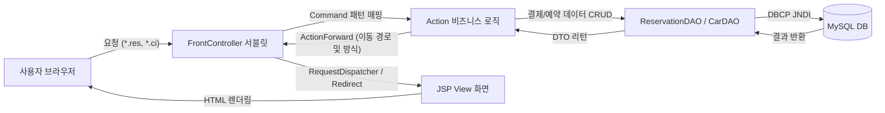
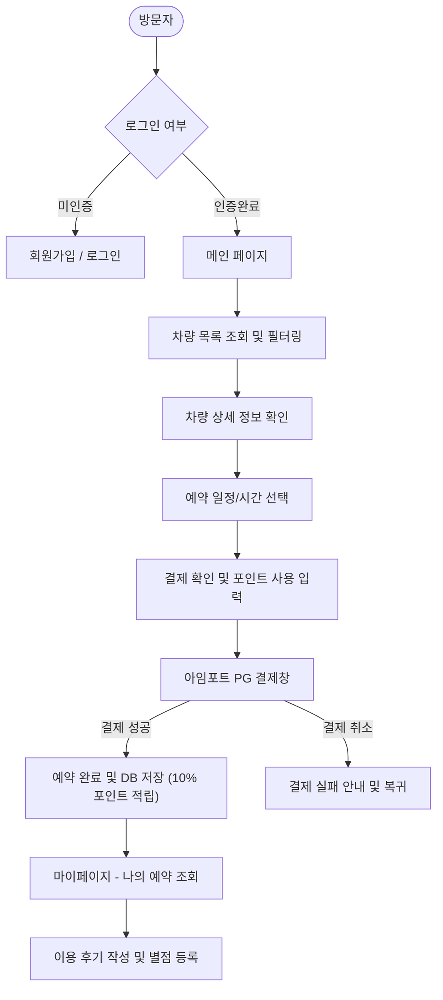
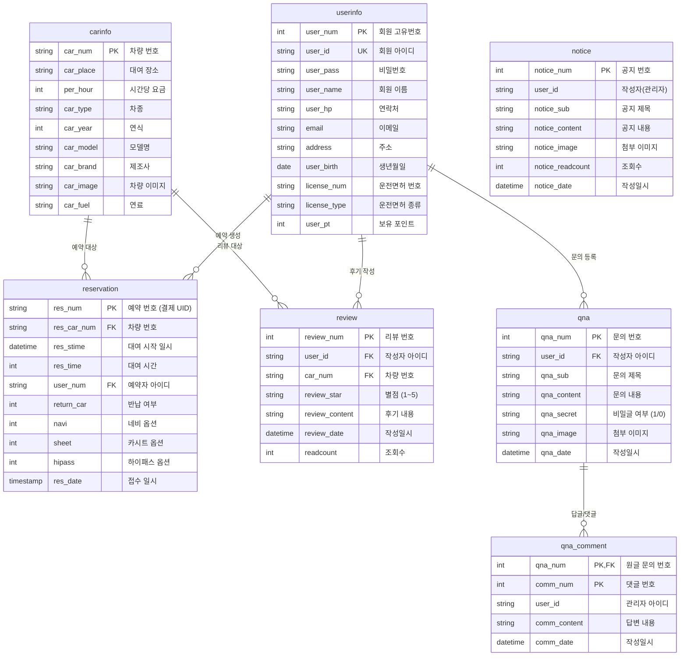

# 🚗 다함께 카차차 (Car! Cha! Cha!) - 차량 대여 및 예약 플랫폼

> **아이티윌 부산 세미프로젝트 (JSP/Servlet 기반 MVC Model 2 웹 애플리케이션)**  
> 코로나19 완화 이후 급증한 국내 여행객과 차박·캠핑족을 위해, 복잡한 렌터카 예약 절차를 간소화하고 실시간 예약부터 결제 API 연동, 이용 후기 및 1:1 고객지원까지 원스톱으로 제공하는 웹 서비스입니다.

---

## 📌 목차
1. [프로젝트 개요](#-프로젝트-개요)
2. [팀원 구성 및 담당 역할](#-팀원-구성-및-담당-역할)
3. [최승현 (본인) 핵심 기여 내용](#-최승현-본인-핵심-기여-내용)
4. [기술 스택 (Tech Stack)](#-기술-스택-tech-stack)
5. [시스템 아키텍처 및 서비스 흐름도](#-시스템-아키텍처-및-서비스-흐름도)
6. [데이터베이스 ERD](#-데이터베이스-erd)
7. [주요 기능 상세](#-주요-기능-상세)
8. [트러블슈팅 & 문제 해결](#-트러블슈팅--문제-해결)
9. [설치 및 실행 가이드](#-설치-및-실행-가이드)

---

## 📖 프로젝트 개요

- **프로젝트명**: 다함께 카차차 (Car! Cha! Cha!)
- **진행 기간**: 2022.12.14 ~ 2023.01.19 (약 5주)
  - `12.14 ~ 12.18`: 주제 선정, 요구사항 분석 및 역할 분담
  - `12.19 ~ 12.25`: DB 모델링(ERD), DB 연동, 기술정의서 작성
  - `12.27 ~ 01.17`: 도메인별 상세 기능 구현 (예약/결제, 회원, 게시판, CSS)
  - `01.17 ~ 01.19`: 외부 API 연동, 예외 처리, 통합 테스트 및 최종 발표
- **기획 배경**:
  - 코로나19 방역 완화로 국내 여행 수요가 급증하고, 차량을 이용한 캠핑('차박') 트렌드 확산
  - 비대면으로 손쉽게 차량 모델과 스펙을 비교하고 실시간 결제까지 완료할 수 있는 플랫폼 구축

---

## 👥 팀원 구성 및 담당 역할

| 이름 | 담당 파트 | 주요 개발 내용 |
|:---:|:---:|:---|
| **최승현 (본인)** | **@예약 / 결제** | **• 실시간 대여 시간/날짜 선택 및 유효성 검증<br>• 아임포트(KG 이니시스) PG사 결제 API 연동<br>• 포인트 사용(차감) 및 결제액 10% 적립 로직 구현<br>• 전체 시스템 에러 수정 및 안정성 리팩토링** |
| **박희원** | @로그인 & 회원가입 | • 회원가입 유효성 검사, 아이디 중복 확인, 카카오 우편번호 API 연동<br>• 아이디/비밀번호 찾기, 회원 목록 리스트 구현 |
| **장진원** | @마이페이지 & DB | • 회원 정보 조회/수정/탈퇴, 마이페이지 구현<br>• 관리자 페이지 예약 조회, 전체적인 DB 설계 및 관리 |
| **고보정** | @공지사항 게시판 | • 관리자 공지사항 CRUD, 파일 첨부 업로드, 조건별 검색 기능<br>• 나의 예약 내역 조회 및 전체 유지보수 |
| **이동신** | @QnA 게시판 | • 1:1 고객문의 CRUD, 비밀글 열람 제어, 카카오 지도 API 연동 |
| **조문영** | @리뷰 게시판 | • 차량 이용 후기 CRUD, 별점(1~5점) 평가 시스템, 팝업창 연동 |
| **조연서** | @전체 CSS / 레이아웃 | • 반응형 레이아웃 구현, 관리자 페이지 캐러셀, 차량 리스트 뷰 디자인 |

---

## 🌟 최승현 (본인) 핵심 기여 내용

본 프로젝트의 핵심 비즈니스 로직인 **[차량 예약 및 결제 시스템]**을 총괄하여 전담 개발했습니다.

### 1. 실시간 차량 예약 및 일정 선택 시스템
- **과거 날짜 예약 차단**: 예약 시점 기준 이전 날짜 및 과거 시간대를 선택할 수 없도록 동적 유효성 검사 적용
- **대여 요금 실시간 계산**: 선택한 차량의 시간당 대여료(`per_hour`)와 선택한 대여 시간(`res_time`)을 실시간 곱연산하여 결제 예상 금액 동적 제시
- **차량 및 회원 데이터 바인딩**: 세션에 로그인된 사용자의 면허 정보 및 선택된 차량의 상세 스펙(모델, 브랜드, 유종, 연식 등)을 DB로부터 연동

### 2. 아임포트(KG 이니시스) PG 결제 API 연동
- **외부 결제 모듈 연동**: JavaScript SDK를 이용한 아임포트 PG 결제창(신용카드, 카카오페이 등) 팝업 구현
- **결제 검증 및 트랜잭션 처리**: 결제 성공 콜백 수신 시 서버로 고유 거래 식별자(`imp_uid`, `merchant_uid`)를 전송하여 예약 내역 DB(`reservation`)에 안전하게 저장
- **결제 취소/실패 예외 처리**: 사용자가 결제창을 도중에 닫거나 잔액 부족 시 결제 실패 팝업 처리 후 이전 페이지로 복귀

### 3. 포인트 적립 및 차감 결제 로직
- 회원이 보유한 포인트(`user_pt`)를 조회하여 결제 시 원하는 만큼 차감 결제할 수 있도록 처리
- 결제 완료 시 총 결제 금액의 **10%를 신규 포인트로 자동 적립**하는 로직 구현

### 4. 전체적인 시스템 에러 수정 및 안정성 개선
- DBCP 커넥션 풀 고갈을 방지하기 위해 전체 DAO 자원 반납(`close()`) 로직 전수 검사 및 보완
- JNDI 리소스 명칭 표준화 및 SQL PreparedStatement 파라미터 인덱스 정합성 교정

---

## 🛠 기술 스택 (Tech Stack)

### Backend
- **Language & Platform**: `Java (JDK 8/11)`, `JSP / Servlet (Java EE 7)`
- **Web Server / WAS**: `Apache Tomcat 9.0`
- **Database**: `MySQL 8.0` (DBCP / JNDI Connection Pool)
- **Library**: `cos.jar` (파일 업로드), `json-simple-1.1.1.jar`

### Frontend
- **Languages**: `HTML5`, `CSS3`, `JavaScript (ES6)`
- **Framework & Libraries**: `jQuery 3.6.3`, `Bootstrap 5`

### External APIs
- **아임포트 (Iamport / 포트원)**: KG 이니시스 온라인 전자결제 모듈
- **카카오 우편번호 API**: 도로명 주소 검색 및 우편번호 자동 입력
- **카카오 지도 API**: 오프라인 렌터카 지점 위치 시각화

---

## 🏛 시스템 아키텍처 및 서비스 흐름도

### MVC Model 2 아키텍처
FrontController가 모든 클라이언트 요청(`*.us`, `*.ci`, `*.res` 등)을 집중 수신하여 전용 Action으로 분기하고, DAO와 View(JSP) 간의 역할을 완벽하게 분리했습니다.



### 전체 서비스 흐름도


---

## 🗄 데이터베이스 ERD



---

## ✨ 주요 기능 상세

### 1. 예약 및 결제 시스템 (최승현 담당)
- **차량 선택 및 스펙 안내**: 차량 예약 탭에서 모델(브랜드, 유종, 차종 등) 선택 시 세부 스펙 표시
- **날짜 및 시간 선택**: 달력 및 시간대(Time Slot) 선택 시 실시간 이용 요금 계산 및 결제 페이지 이동
- **아임포트 결제 API**: 신용카드, 카카오페이 등 다양한 결제 수단 제공, 포인트 차감 결제 지원
- **포인트 적립**: 결제 성공 시 결제 총액의 10% 자동 적립
- **결제 상태 관리**: 결제 성공 시 예약 테이블(`reservation`) 인서트, 취소 시 안내 팝업 후 롤백

### 2. 회원 관리 및 인증
- **회원가입**: 아이디 중복 체크 팝업, 비밀번호 일치 검사, 카카오 우편번호 API 연동, 면허번호 유효성 검사, 만 18세 이상 성인 가입 제한(`min/max date`)
- **로그인/로그아웃**: 세션(`HttpSession`)을 활용한 전역 로그인 상태 관리, 아이디/비밀번호 찾기
- **마이페이지**: 개인정보 조회/수정, 비밀번호 재확인을 통한 안전한 회원 탈퇴

### 3. 차량 관리 (관리자)
- 차량 번호, 대여 지역, 시간당 금액, 차종, 연식, 모델, 브랜드, 유종, 차량 이미지 등록 및 관리

### 4. 이용 후기 및 게시판 시스템
- **리뷰 게시판**: 마이페이지 예약 조회 연동, 1~5점 별점 부여 및 후기 작성/수정/삭제
- **공지사항 게시판**: 관리자 공지 작성, `cos.jar`를 이용한 다중 이미지 첨부, 이전글/다음글 이동, 제목/내용/작성자 조건별 검색
- **1:1 문의사항 (QnA)**: 작성자 및 관리자만 열람할 수 있는 비밀글 잠금 모드, 관리자 실시간 답글 작성 기능

---

## 🔧 트러블슈팅 & 문제 해결

### 1. DBCP 커넥션 풀 고갈(Connection Leak) 방지
- **문제 현상**: 사용자 요청이 누적되면 톰캣 서버가 응답을 멈추고 DB 접속이 지연되는 현상 발생.
- **원인 분석**: 일부 DAO 메서드의 `finally` 블록에서 `Connection` 및 `PreparedStatement`의 `close()` 호출이 누락되어 커넥션 풀이 반납되지 않음.
- **해결 방법**: 모든 DAO 메서드의 `finally` 블록에서 자원을 안전하게 반환하도록 표준화하여 자원 누수를 원천 방지.

### 2. JNDI Resource 명칭 불일치 해결
- **문제 현상**: 예약 모듈 실행 시 `NamingException: Name [jdbc/cafe_pcc] is not bound in this Context` 에러 발생.
- **원인 분석**: 초기 실습 템플릿의 JNDI 이름(`jdbc/cafe_pcc`)이 남아있어 `context.xml`의 실제 이름(`jdbc/Mysql`)과 불일치.
- **해결 방법**: `ReservationDAO`의 lookup 대상을 `java:comp/env/jdbc/Mysql`로 일원화하여 해결.

### 3. PreparedStatement 파라미터 인덱스 중복 매핑 수정
- **문제 현상**: 예약 저장 시 SQL 바인딩 파라미터 누락으로 인한 런타임 SQL 에러 발생.
- **원인 분석**: `pstmt.setInt(4, time)`과 `pstmt.setString(4, userId)`처럼 4번 인덱스가 덮어씌워지고 5번 파라미터가 누락됨.
- **해결 방법**: 파라미터 인덱스를 1~5번까지 순차적으로 정상 매핑하여 예약 데이터가 정상 저장되도록 조치.

### 4. 세션 식별자 불일치 호환성 개선
- **문제 현상**: 로그인 후 일부 페이지에서는 로그인 상태가 정상 인식되나 다른 페이지에서는 로그인이 풀려 보이는 문제 발생.
- **원인 분석**: 로그인 컨트롤러에서 세션 키로 `sessionId`를 저장했으나, 일부 JSP에서는 `user_id`를 조회하여 발생.
- **해결 방법**: `UserLoginPro`에서 `sessionId`와 `user_id`를 모두 세션에 등록하여 모든 화면에서 완벽하게 호환되도록 개선.

---

## 🚀 설치 및 실행 가이드

### 1. 환경 요구사항
- **Java**: JDK 8 또는 11
- **Server**: Apache Tomcat 9.0
- **Database**: MySQL 8.0 이상

### 2. 데이터베이스 설정
프로젝트 루트의 `schema.sql`을 실행하여 데이터베이스와 테이블, 기초 데이터를 생성합니다:
```bash
mysql -u root -p < schema.sql
```

### 3. DBCP JNDI 설정 (`context.xml`)
`Project_Car/src/main/webapp/META-INF/context.xml` 파일의 DB 계정 정보를 로컬 환경에 맞게 수정합니다:
```xml
<Context>
    <Resource name="jdbc/Mysql"
              auth="Container"
              type="javax.sql.DataSource"
              driverClassName="com.mysql.cj.jdbc.Driver"
              url="jdbc:mysql://localhost:3306/class2_220922_team1?serverTimezone=Asia/Seoul&amp;useSSL=false"
              username="YOUR_USERNAME"
              password="YOUR_PASSWORD"
              maxTotal="20"
              maxIdle="10"
              maxWaitMillis="-1" />
</Context>
```

### 4. 프로젝트 실행
1. Eclipse에서 `Project_Car`를 **Existing Projects into Workspace**로 가져옵니다.
2. Tomcat 9.0 서버에 `Project_Car`를 추가합니다.
3. 브라우저에서 `http://localhost:8080/Project_Car/` 또는 `http://localhost:8080/Project_Car/UserHome.us` 로 접속합니다.
